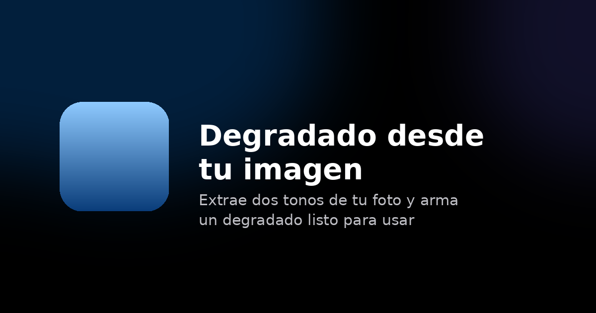

<div align="center">

  

  <h1>Degradado desde tu imagen</h1>

  <p>
    Sube una foto y obtén al instante un degradado de dos tonos extraídos de sus colores reales,
    con contraste WCAG AA garantizado para texto negro o blanco.
  </p>

  <p>
    
    
    
    
    
    
  </p>

  <p>
    <a href="#vision-general">Vision general</a> &middot;
    <a href="#funcionalidades">Funcionalidades</a> &middot;
    <a href="#estructura-del-proyecto">Estructura</a> &middot;
    <a href="#como-funciona">Como funciona</a> &middot;
    <a href="#uso-local">Uso local</a>
  </p>

  <br>

  

</div>

---

## Vision general

**Degradado desde tu imagen** es una herramienta web que analiza los colores dominantes de una
imagen y genera un degradado de dos tonos extraídos directamente de ella, garantizando en todo
momento que el texto — negro o blanco — tenga suficiente contraste para ser legible (WCAG AA, ratio
minimo de 4.5:1).

El análisis ocurre completamente en el navegador, sin servidores, sin APIs externas y sin subir
ningún dato a ningún lado.

---

## Funcionalidades

- **Tres formas de cargar una imagen** — arrastra y suelta, haz clic para seleccionar, o pega
  directamente desde el portapapeles con `Ctrl+V`
- **Carga por URL** — pega el enlace de cualquier imagen pública compatible con CORS
- **Modos texto negro y blanco** — cambia entre ambos en tiempo real; los colores se recalculan
  automáticamente para mantener el contraste
- **Variantes** — el botón "Otro" cicla entre las zonas de color distintas detectadas en la imagen,
  sin repetir tonos indistinguibles
- **Expandir selección** — alterna entre analizar solo los bordes (14%) o toda la mitad
  superior/inferior de la imagen (50%)
- **Copia con un clic** — copia el HEX de cada color directamente al portapapeles
- **Sin dependencias** — cero librerías externas; HTML, CSS y JavaScript puros
- **Accesible** — navegación por teclado completa, roles ARIA, respeto a `prefers-reduced-motion`
- **Responsive** — funciona en cualquier tamaño de pantalla

---

## Estructura del proyecto

```
Degradados/
  index.html              Pagina principal
  404.html                Pagina de error personalizada
  robots.txt              Configuracion de indexacion para buscadores
  sitemap.xml             Mapa del sitio
  CHANGELOG.md            Registro de cambios
  LICENSE                 Licencia propietaria
  assets/
    favicon.svg           Icono del sitio
    social-preview.png    Imagen para redes sociales (Open Graph / Twitter Card)
  css/
    styles.css            Estilos generales compartidos
    404.css               Estilos especificos de la pagina 404
  js/
    config.js             Constantes globales y parametros de configuracion
    color-math.js         Conversion RGB/HSL/HEX y calculo de contraste WCAG
    sampler.js            Analisis de pixeles y agrupacion por matiz (cubetas)
    contrast-adjust.js    Ajuste de luminosidad para garantizar WCAG AA
    app.js                Estado de la aplicacion, DOM y manejo de eventos
```

---

## Como funciona

El pipeline de analisis sigue estos pasos:

### 1. Reduccion de resolucion

La imagen se dibuja en un `<canvas>` oculto redimensionado a un maximo de 240 px en el lado mayor.
Esto hace el analisis rapido incluso para imagenes de alta resolucion.

### 2. Muestreo ponderado

Los pixeles se leen de la zona superior o inferior segun el modo activo. Cada pixel recibe un peso
segun dos criterios:

- **Peso vertical** — los pixeles en el borde exterior de la imagen pesan mas que los del limite
  interior de la zona; se prioriza lo que realmente esta en el borde.
- **Peso horizontal** — los costados pesan mas que el centro; se evita que el sujeto principal
  (tipicamente centrado) domine el color resultante.

### 3. Agrupacion por matiz (cubetas)

Los pixeles se clasifican en 12 cubetas de 30° de matiz (modelo HSL). Los pixeles con saturacion
inferior al umbral neutral se agrupan aparte para no mezclarlos con colores reales.

### 4. Seleccion de candidatos

Las cubetas se ordenan por peso total. Solo cuentan las que superen el 3% del peso acumulado. Se
descartan los candidatos demasiado similares entre si (diferencia minima en matiz, saturacion o
luminosidad) para que "Otro" siempre ofrezca variantes perceptiblemente distintas.

### 5. Ajuste de contraste WCAG AA

El color seleccionado se lleva al espacio HSL y se ajusta la luminosidad en pasos de 1.5 hasta
alcanzar un ratio de contraste minimo de 4.5:1 con el color de texto elegido (negro o blanco),
dentro de los limites del modo activo.

### 6. Separacion del degradado

Si el color de arriba y el de abajo quedan demasiado parecidos (diferencia de luminosidad menor a
16 puntos o distancia RGB menor a 30), se separan simetricamente alrededor de su punto medio para
garantizar que el resultado siempre luzca como un degradado real y no como un color plano.

---

## Uso local

No se requieren herramientas de instalacion ni servidores de aplicaciones. El proyecto es HTML
estatico puro.

```bash
# Clona el repositorio
git clone https://github.com/exsaj/degradados.git
cd degradados

# Abre directamente en el navegador
# Windows
start index.html

# macOS
open index.html

# Linux
xdg-open index.html
```

> Algunas funcionalidades como la carga por URL requieren que el servidor de origen de la imagen
> permita CORS. Esto es una restriccion del navegador, no del proyecto.

---

## Parametros de configuracion

Todos los parametros de comportamiento del algoritmo estan centralizados en [`js/config.js`](js/config.js).
No hay numeros magicos dispersos en el codigo.

| Parametro | Valor | Descripcion |
|-----------|-------|-------------|
| `SAMPLE_MAX_DIMENSION` | 240 px | Resolucion maxima del canvas de analisis |
| `BAND_FRACTION_EDGES` | 14% | Altura de zona analizada en modo bordes |
| `BAND_FRACTION_FULL` | 50% | Altura de zona analizada en modo expandido |
| `HUE_BUCKET_COUNT` | 12 | Numero de cubetas de matiz (30° cada una) |
| `MIN_CANDIDATE_WEIGHT_SHARE` | 3% | Peso minimo para que una cubeta cuente como variante |
| `MIN_CONTRAST_AA` | 4.5 | Ratio minimo de contraste WCAG AA |
| `MIN_GRADIENT_L_SEPARATION` | 16 | Diferencia minima de luminosidad entre los dos colores |

---

## Modulos JavaScript

| Archivo | Responsabilidad | Dependencias |
|---------|----------------|--------------|
| `config.js` | Constantes globales | — |
| `color-math.js` | Conversiones de color y contraste | — |
| `sampler.js` | Analisis de imagen | `config.js`, `color-math.js` |
| `contrast-adjust.js` | Ajuste WCAG | `config.js`, `color-math.js` |
| `app.js` | UI, estado y eventos | Todos los anteriores |

Los modulos se cargan como scripts clasicos en orden de dependencia. No se usa un bundler para
mantener el proyecto libre de herramientas de build.

---

## Licencia

Copyright (c) 2026 exsaj. Todos los derechos reservados.

Este proyecto es software propietario. No esta permitido copiar, modificar, distribuir ni usar
ninguna parte de este proyecto sin autorización expresa y por escrito del titular del copyright.

Consulta el archivo [LICENSE](LICENSE) para los terminos completos.
